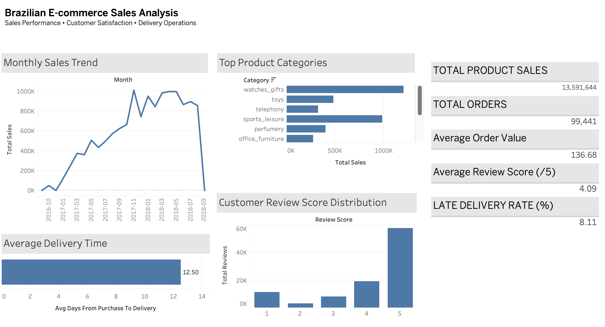

# Olist E-commerce Sales Analysis

## Project Overview

This project analyzes e-commerce sales data to identify sales trends, top-performing product categories, customer review patterns, and delivery performance.

The goal is to turn raw data into useful business insights using SQL and Tableau.

## Tools & Technologies

- MySQL Workbench
- SQL
- Tableau
- CSV data exports

## Business Questions

1. How do sales and order volumes change over time?
2. Which product categories generate the highest sales?
3. What is the average customer review score?
4. How long does delivery take on average?
5. What percentage of delivered orders arrive later than estimated?

## Key Performance Indicators

| Metric | Result |
|---|---:|
| Total Product Sales | 13,591,643.70 |
| Total Orders | 99,441 |
| Average Order Value | 136.68 |
| Average Review Score | 4.09 / 5 |
| Late Delivery Rate | 8.11% |
| Average Delivery Time | 12.50 days |

## Key Findings

### 1. Monthly Sales

November 2017 generated 1,010,271.37 in sales from 7,451 orders, compared with 664,219.43 in sales from 4,568 orders in October 2017.

Sales increased by approximately 52.1%, alongside an increase in order volume.

### 2. Top Product Categories

Health & Beauty, Watches & Gifts, and Bed Bath & Table were among the highest-selling product categories across the dataset.

### 3. Delivery Performance

Of 96,478 delivered orders, 7,826 arrived later than estimated, giving a late delivery rate of approximately 8.11%.

### 4. Customer Reviews

The average customer review score was 4.09 out of 5. Further analysis could explore the relationship between delivery delays and customer satisfaction.

## Dashboard

The Tableau dashboard includes:

- Monthly Sales Trend
- Top Product Categories
- Customer Review Score Distribution
- Average Delivery Time
- Sales and Delivery KPIs

## Recommendations

- Investigate factors contributing to monthly sales growth.
- Monitor sales performance across product categories.
- Identify potential causes of late deliveries.
- Explore the relationship between delivery performance and customer reviews.

## Skills Demonstrated

- SQL data analysis
- KPI calculation
- Data aggregation
- Tableau dashboard development
- Business insight generation
- Analytical thinking

## Project Status

Initial data analysis and dashboard development completed.

## Dashboard Preview

